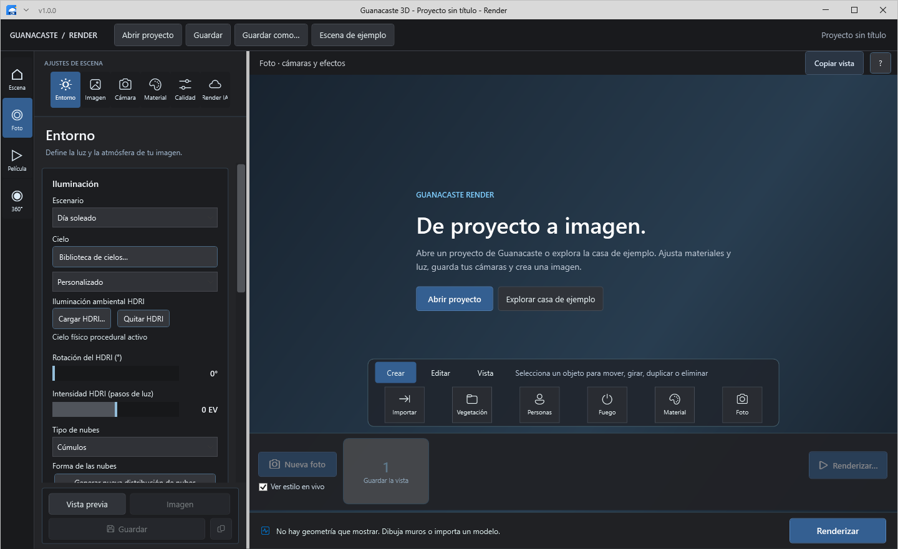
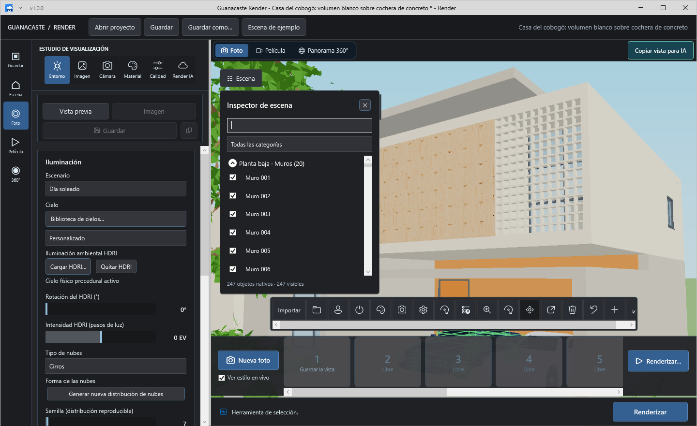
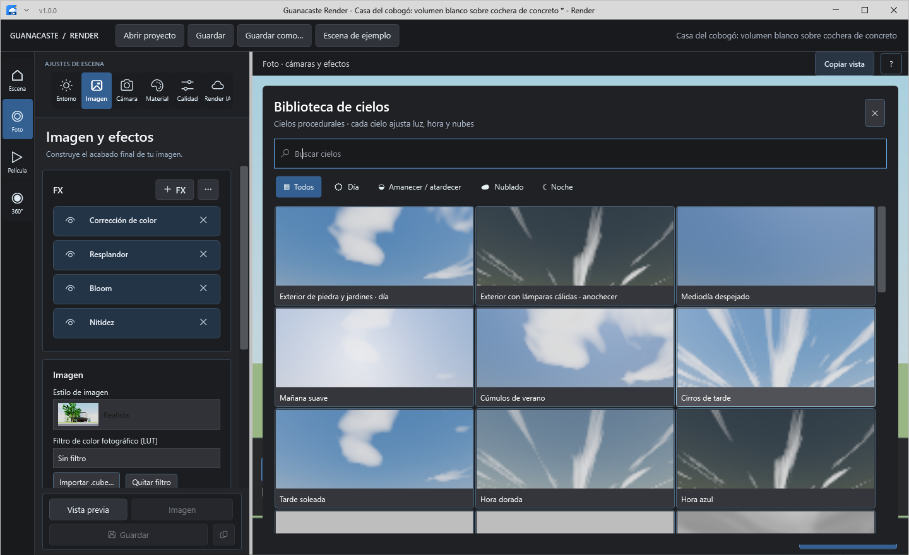
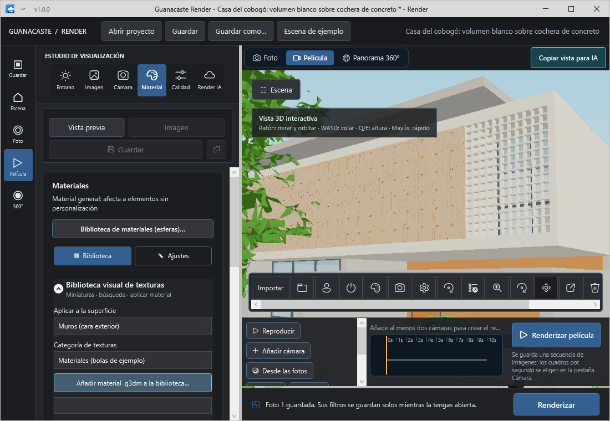
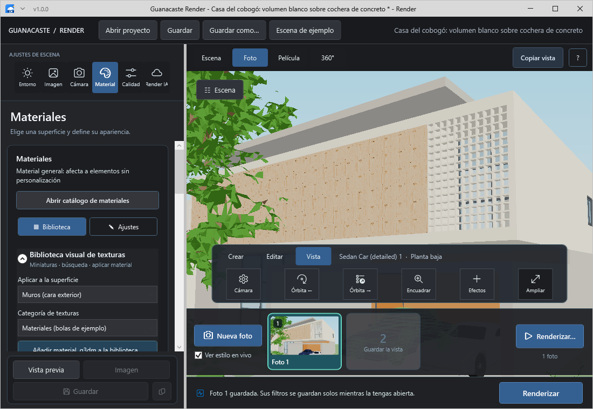
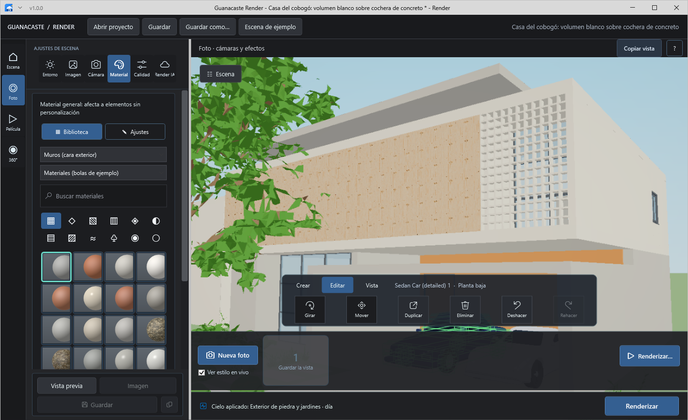
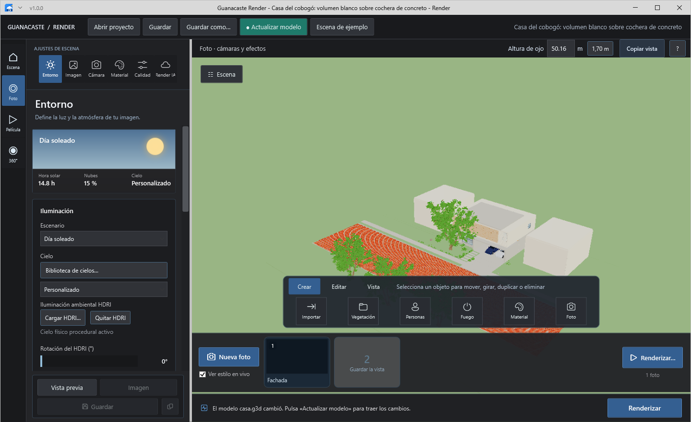
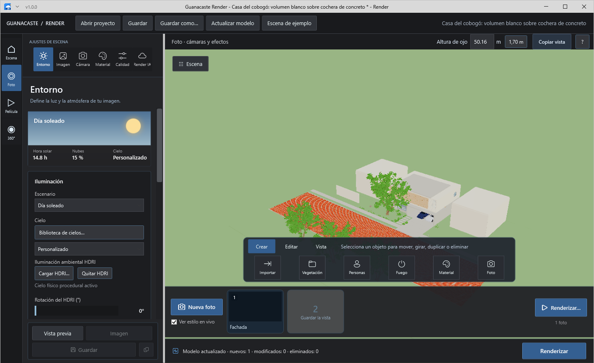
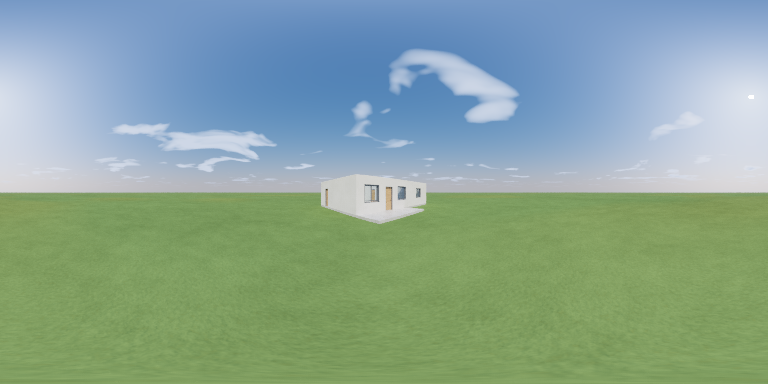

# Interfaz de Guanacaste Render

Capturas generadas por los controles WPF reales durante las pruebas del estudio. La escena es la casa de ejemplo incluida en el proyecto.

## Inicio

Acceso directo a proyectos y a la escena de ejemplo, con una introducción al flujo de trabajo.

## Inspector

Selección y visibilidad por objeto, búsqueda y filtro por categoría sobre el documento nativo.

## Cielos

Biblioteca de cielos procedurales con miniaturas, búsqueda y aplicación de iluminación.

## Película en ventana compacta

Ventana de 1100 × 760: herramientas con nombre agrupadas por tarea, línea de tiempo y exportación accesibles.

## Herramientas de escena

Selección visible, deshacer/rehacer y acciones habilitadas según el tipo de objeto. Las 18 herramientas se reparten en Crear, Editar y Vista: seis por grupo, sin desplazamiento horizontal. La barra vertical unifica Escena, Foto, Película y 360°. El panel lateral mide 340 píxeles inicialmente y la ayuda se muestra bajo demanda.

Validación de esta revisión: 63 comprobaciones del estudio, incluyendo comandos de edición, protección del muro anfitrión, biblioteca de efectos, modo ampliado, distribución compacta, bloqueo durante render y exportación de PNG.

Para regenerar las capturas: `$env:G3D_ONLY='studio'; dotnet run --project tests/desktop-interaction-checks -c Release`. Los resultados nuevos se guardan en `artifacts/studio-checks`.

## Materiales

Búsqueda visible, categorías por iconos, dieciséis miniaturas por página y pestañas Biblioteca/Ajustes. La ventana ampliada permite activar cada miniatura con el teclado.

## Correspondencia con las referencias

| Referencias locales | Adaptación funcional |
| --- | --- |
| Inspector de escena, capas y selección | Jerarquía por nivel/categoría, búsqueda, filtros y visibilidad persistente |
| Biblioteca y editor de materiales | Cuadrícula, categorías, superficie, color, escala, relieve, rugosidad y metal |
| Crear y editar agua | Categoría Agua con materiales aplicables; nivel y oleaje del agua de entorno en Entorno |
| Biblioteca de cielos, efecto y HDR | Miniaturas filtrables, HDRI, rotación e intensidad |
| Colocación de grupo, línea y masiva | Tres paneles para objeto, distribución y variación; colocación deshacible |
| Gizmo mover y rotar | Ejes de traslado y anillo de giro en Z, gesto único deshacible |
| Foto y cámaras | Miniaturas, actualizar encuadre al pasar el cursor, duplicar y eliminar |
| Opciones avanzadas y ray tracing | Acciones compatibles con la selección, calidad y efectos reales del motor |

Las capturas son la referencia visual; esta implementación conserva las capacidades del motor de Guanacaste. No presenta controles decorativos para propiedades que el motor no implementa. El giro es en el plano y no ofrece inclinación de objetos en X/Y.

## Actualizar modelo

Cuando Guanacaste 3D guarda de nuevo el modelo, la barra superior resalta «Actualizar modelo». Al pulsarlo, el muro añadido en el modelo aparece en la escena y se conservan la cámara, la foto, el material y los objetos colocados en el estudio. Capturas de la suite `model-update`.

## Panorama 360°

Imagen equirrectangular de la casa de demostración generada por `render-panorama-checks` (768 × 384, 24 muestras por píxel en CPU).

